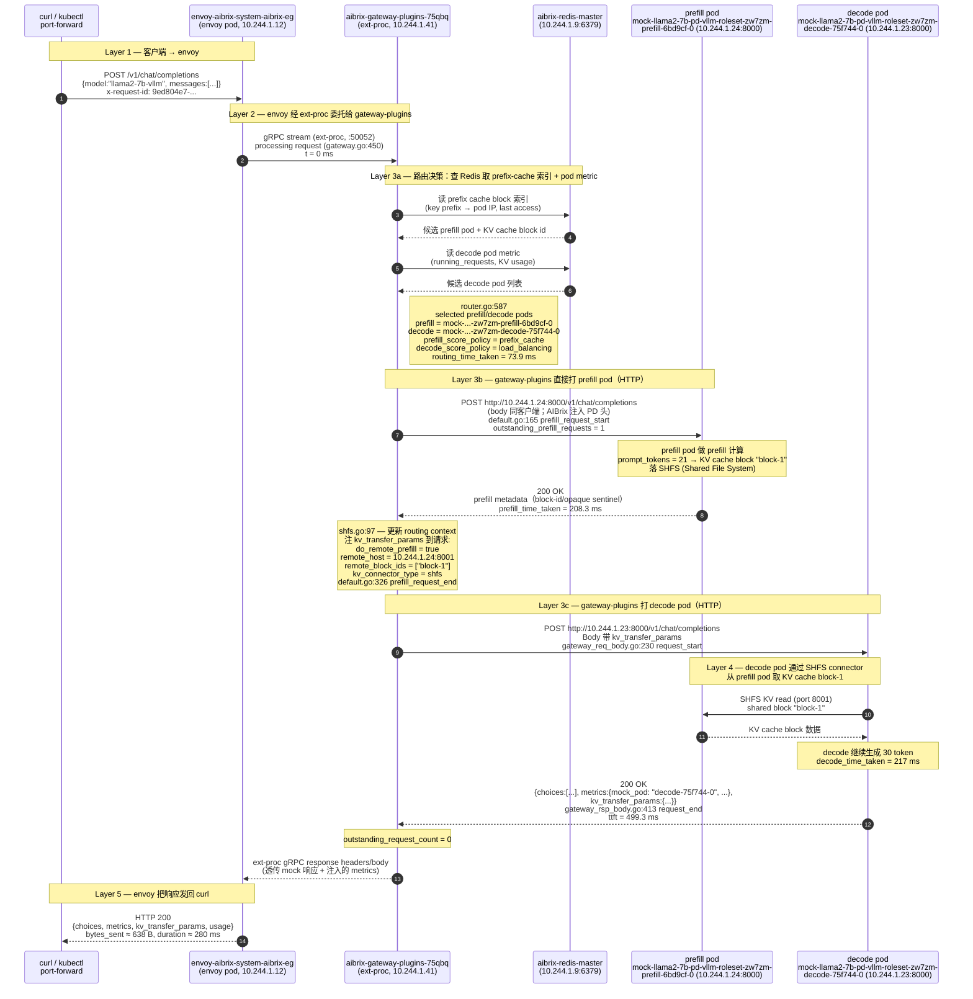

# AIBrix 端到端请求时序图

按一次 `POST /v1/chat/completions`（model=`llama2-7b-vllm`，PD 路由）的真实日志还原。

- request_id: `9ed804e7-be54-468d-b40f-ee6a749b1348`
- 客户端：`curl http://localhost:8888/v1/chat/completions`
- prompt_tokens: 21，completion_tokens: 30

时序对应 gateway-plugins pod `aibrix-gateway-plugins-6bdc64876d-75qbq` 的日志。
所有时间戳相对 `t0 = 07:43:39.252614`（`gateway.go:450` 入口）。

## 时序图

## 时序关键时间点（从日志反推）

| 相对 t0 (ms) | 阶段 | 来源 |
|-------------|------|------|
| 0 | gateway-plugins 收到 ext-proc 流 | `gateway.go:450` |
| ~0–73 | 路由决策（查 Redis + 选 pod） | `router.go:587` `routing_time_taken=73.94ms` |
| 73 | prefill 请求发出 | `default.go:165 prefill_request_start` |
| 281 | prefill 完成，return 208ms | `default.go:326 prefill_request_end` `prefill_time_taken=208.3ms` |
| 282 | decode 请求发出 | `gateway_req_body.go:230 request_start` |
| 499 | decode 完成，return 217ms | `gateway_rsp_body.go:413 request_end` `decode_time_taken=217ms` `kv_transfer_time_taken=217ms`（与 decode 并行重叠） |
| 499 | gateway-plugins 回 envoy | `total_time_taken=499.4ms` |
| 580 | envoy 回 curl | envoy 日志 `duration=280ms` (其中部分是 ext-proc 调度开销) |

> 注：日志里的 `kv_transfer_time_taken` 与 `decode_time_taken` 数值相同（217ms），
> 说明在 mock 环境下两者是 **同一段计时重叠**：decode pod 内部"取 KV cache"和"继续生成"
> 在 mock 里被合并计为一次 HTTP RTT。真实 vLLM + SHFS 场景下两者应分开。

## 涉及到的 pod 速查表

| 角色 | Pod 名称 | IP | 关键标签 |
|------|---------|----|---------|
| Envoy 数据面 | `envoy-aibrix-system-aibrix-eg-903790dc-7ffb6c4f8b-zrhbx` | 10.244.1.12 | kind-worker |
| Gateway Plugins (主) | `aibrix-gateway-plugins-6bdc64876d-75qbq` | 10.244.1.41 | 主路径 |
| Gateway Plugins (备) | `aibrix-gateway-plugins-6bdc64876d-nm8md` | 10.244.1.40 | HA, 待命 |
| Redis | `aibrix-redis-master-67964b778f-8wswh` | 10.244.1.9 | prefix cache 索引/pod metric |
| Prefill Pod | `mock-llama2-7b-pd-vllm-roleset-zw7zm-prefill-6bd9cf-0` | 10.244.1.24 | role=prefill, port 8000/8001 |
| Decode Pod | `mock-llama2-7b-pd-vllm-roleset-zw7zm-decode-75f744-0` | 10.244.1.23 | role=decode |
| Controller Manager | `aibrix-controller-manager-6fb46799cd-5prjq` | 10.244.1.3 | 链路外（CR reconcile） |

## 复盘要点

1. **2 副本 gateway-plugins + Redis**：保证 ext-proc 链路高可用；两副本通过 Redis 同步 prefix cache 索引与 pod metric。
2. **三跳路由**：
   - envoy → gateway-plugins 用 **gRPC ext-proc**（50052），不是代理转发
   - gateway-plugins → prefill/decode pod 用 **HTTP**（8000），按 pod IP 直连
3. **PD 路由策略**：`prefill_score_policy = prefix_cache`、`decode_score_policy = load_balancing`，
   分别独立打分；选出来的 prefill/decode 属于同一 roleset (zw7zm)，避免跨 roleset 取 KV cache。
4. **KV transfer 通过 SHFS**：`kv_connector_type=shfs`（Shared File System connector），
   vLLM 通过 `kv_transfer_params.remote_host:remote_port=8001` 读 prefill 写的共享 block。
5. **响应携带 mock 自报告 metrics**：`metrics.mock_pod`、`mock_latency_seconds`、`time_to_first_token_seconds`
   都由 mock pod 在响应体里附加，gateway-plugins 不修改。
6. **整链路 499 ms**，瓶颈在 mock prefill 208ms + decode 217ms，二者顺序执行（logically）。
   真实 GPU 推理下，decode 通常远比 prefill 慢且 token 数决定总时长。
